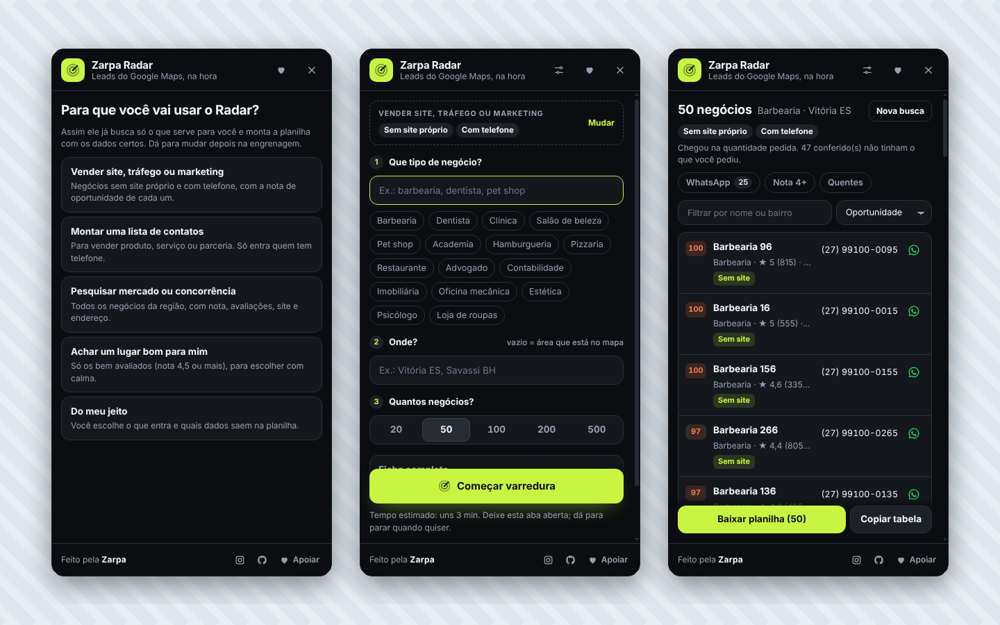

# Zarpa Radar

**Leads do Google Maps, na hora.** Extensão para Chrome: você abre o Google Maps, diz o nicho e a cidade, e o Radar varre os resultados e entrega nome, telefone, WhatsApp, site, nota e endereço de cada negócio, prontos para baixar em planilha.

Grátis, de código aberto, sem cadastro e sem servidor: tudo roda no seu navegador.

<p align="center"></p>

## Como usar

1. **Instale** (2 minutos, veja abaixo) e abra o [Google Maps](https://www.google.com/maps).
2. Clique no botão **Radar**, no canto de cima à direita do mapa.
3. Na primeira vez ele pergunta **para que você vai usar**. Cada resposta já deixa o Radar ajustado:

   | Para quê | Quem entra na lista | O que sai na planilha |
   |---|---|---|
   | Vender site, tráfego ou marketing | só quem **não tem site próprio** e tem telefone | tudo, mais a nota de oportunidade (quente, morno, frio) |
   | Montar uma lista de contatos | só quem tem telefone | nome, categoria, telefone, WhatsApp, cidade, link do Maps |
   | Pesquisar mercado ou concorrência | todos | nota, avaliações, site, Instagram, endereço |
   | Achar um lugar bom para mim | só nota 4,5 ou mais | telefone, site, nota, endereço |
   | Do meu jeito | você escolhe | você escolhe |

   Dá para mudar a qualquer hora na engrenagem do painel: site (tanto faz, sem site próprio, com site), contato (tanto faz, com telefone, com WhatsApp), nota mínima e quais colunas vão para a planilha.
4. Escreva o **nicho** (ou toque num atalho: Barbearia, Dentista, Clínica, Pet shop…), a **cidade** (ou deixe vazio para usar a área que está no mapa) e **quantos** quer: 20, 50, 100, 200 ou 500.
5. **Começar varredura.** Deixe a aba aberta. O painel mostra quantos já achou e você pode parar quando quiser, sem perder nada.
6. No fim: filtre (sem site, WhatsApp, nota 4+), ordene, clique no telefone para copiar, no ícone verde para abrir o WhatsApp, e **Baixar planilha** (abre no Excel e no Google Planilhas) ou **Copiar tabela** para colar direto numa planilha.

Atalho de teclado no Maps: <kbd>Alt</kbd> + <kbd>Shift</kbd> + <kbd>R</kbd>.

## Instalar

1. Baixe este repositório: botão verde **Code → Download ZIP**, e descompacte numa pasta fixa, por exemplo `Documentos/zarpa-radar`. Não apague essa pasta depois.
2. No Chrome, abra `chrome://extensions` e ligue o **Modo do desenvolvedor** (canto de cima, à direita).
3. Clique em **Carregar sem compactação** e escolha a pasta que tem o arquivo `manifest.json`.
4. Fixe o ícone na barra (ícone de quebra-cabeça → alfinete). O Google Maps abre sozinho com o painel.

Funciona no Chrome, Edge, Brave e outros navegadores com base no Chromium.

## Por que os resultados são precisos

- **Ficha completa.** O Radar abre a ficha de cada negócio e lê telefone, site e endereço exatamente como o Google mostra, em vez de adivinhar pelo cartão da lista. Quando você filtra por site ou telefone, isso fica ligado sempre, porque só a ficha mostra esses dados com certeza.
- **Conta só quem serve.** Se você pediu 100 "sem site e com WhatsApp", ele confere quantos precisar até achar 100 que batem. O painel mostra os dois números ("217 conferidos · 100 com o que você pediu").
- **Passa do limite do Maps.** Uma busca no Maps para em cerca de 120 resultados. Quando o Radar chega nesse teto, ele faz buscas menores nos arredores (em grade, do centro para fora) e junta tudo, sem repetir ninguém.
- **Deixa de fora quem fechou de vez.** E marca "Fechado temporariamente", "Ficha sem dono" (a ficha do Google não foi reivindicada) e "Anuncia no Google".
- **Site de verdade x rede social.** Instagram, Linktree, Facebook e apps de agenda (Trinks, Booksy, AppBarber…) contam como **sem site próprio**, porque para quem vende site é exatamente esse o cliente.
- **WhatsApp só para celular.** O botão e a coluna do WhatsApp aparecem para números de celular (DDD + 9), não para fixo.

## Perguntas

**É grátis mesmo? Tem limite?** Sim e não. Não usa chave de API nem conta em lugar nenhum.

**Quanto tempo leva?** Com ficha completa, cerca de 1 a 2 segundos por negócio conferido. 100 resultados levam uns 3 a 6 minutos, mais se os filtros recusarem muitos. Sem ficha completa (só possível quando não há filtro de site ou telefone) é bem mais rápido.

**Posso usar o computador enquanto isso?** Pode, só não feche nem recarregue a aba do Maps. Se ela recarregar, o Radar continua de onde parou.

**Meus dados vão para algum lugar?** Não. As buscas e os resultados ficam só no armazenamento local da extensão, no seu navegador. Veja [PRIVACY.md](PRIVACY.md).

**Parou de funcionar.** O Google muda o Maps de vez em quando. Abra uma [issue](../../issues) com um print; os pontos que leem a página ficam todos em `content/scanner.js`.

## Use com responsabilidade

O Radar só lê o que o próprio Google Maps mostra na sua tela, no ritmo de uma pessoa clicando, sem pedidos escondidos. Mesmo assim, a forma como você usa os contatos é responsabilidade sua: respeite a LGPD, não mande spam e ofereça sempre um jeito de a pessoa pedir para não ser mais contatada. Uso pesado e contínuo pode fazer o Google pedir uma verificação; nesse caso, espere um pouco e tente de novo.

## ☕ Apoie


O Zarpa Radar é grátis. Se ele te ajudou a fechar cliente, pague um café pro dev, no Pix, valor livre. Também tem o QR no próprio painel (ícone de coração).

Chave Pix: `contato@zarpadev.com.br`

Pix copia e cola:

```
00020126450014br.gov.bcb.pix0123contato@zarpadev.com.br5204000053039865802BR5911KAUA PESSIN6007VITORIA62070503***6304A70B
```

## Feito pela Zarpa

Precisa de site, sistema ou automação sob medida? A **Zarpa Dev** faz, do jeito que este Radar foi feito.
[zarpadev.com.br](https://zarpadev.com.br/?utm_source=zarpa-radar) · Instagram [@zarpa.dev](https://www.instagram.com/zarpa.dev/)

## Para desenvolvedores

Manifest V3, JavaScript puro, sem build e sem dependências.

```
manifest.json         permissões: só "storage"; roda só em google.com(.br)/maps
background.js         atalho de teclado e mensagens do popup
content/core.js       lógica pura: telefone, site, filtros, nota de oportunidade, planilha, Pix, grade de busca
content/scanner.js    leitura da página do Maps (lista e ficha); todos os seletores ficam aqui
content/panel.js      painel (Shadow DOM) e o motor da varredura, que sobrevive à troca de página
popup/                janelinha do ícone
tests/                core.test.mjs (Node) e e2e.py (Playwright + um Maps de mentira, sem internet)
```

```
node tests/core.test.mjs             # testes da lógica
node scripts/check.mjs               # manifest, arquivos citados e sintaxe de todo JS
python3 tests/e2e.py prints/         # carrega a extensão num Chromium e faz varreduras completas
```

Pull requests são bem-vindos. Licença MIT, veja [LICENSE](LICENSE). Não é afiliado ao Google; Google Maps é marca do Google LLC.

---

### English

Chrome extension that turns a Google Maps search into a lead list: type a niche and a city, choose what you need (with or without a website, with a phone or WhatsApp, minimum rating, which columns to export) and download a CSV with name, phone, WhatsApp link, website, rating, reviews and address. It opens each place to read exact data, goes past Maps' ~120-result cap by searching a grid around the city, and keeps everything local in your browser. Install: `chrome://extensions` → Developer mode → Load unpacked → pick this folder. MIT licensed, made by [Zarpa](https://zarpadev.com.br).
